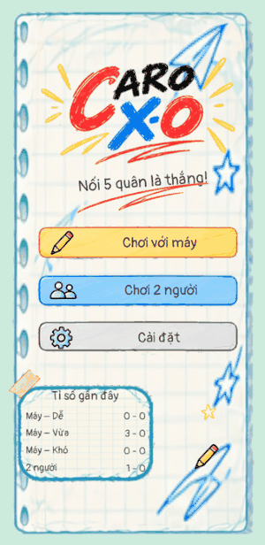

# Caro X-O

  

**Caro X-O** is a hand-drawn notebook-style **Caro (Gomoku, five in a row)** game for Android, built with Unity.
Play against a three-level AI or with a friend on the same phone.

[**⬇ Download the APK**](https://github.com/tuankun-279/Caro_XO/releases/latest) · Unity 6000.0.76f1 · URP 2D · Portrait

## Features

- **Vs AI** with three clearly different levels (Easy, Medium, Hard) or **2 players** on one device
- **Growing board**: starts at 15 × 15 and expands up to 20 × 20 when a move lands near the edge
- Pinch to zoom, drag to pan, **undo** and resume an unfinished game
- **Pen-and-paper feel**: X and O are drawn stroke by stroke, undo erases them diagonally, with recorded pencil sounds
- Choose who moves first, sound, vibration and volume settings; recent scores per mode
- Vietnamese UI, with all text rendered by the engine (no text baked into images) so it can be localized

## The AI

The AI lives in a plain C# assembly (`Caro.AI`) with no Unity dependency, so it runs on a background thread
and is fully unit-tested.

- **Candidate moves**: only empty cells within two cells of a stone, ranked by a shape score for both
  attack and defence (five, open four, four, open/broken three, twos) with bonuses for double threats.
- **Easy** plays like a beginner: it takes a win about 80 % of the time, blocks a four about 60 % of the time
  and otherwise plays loosely near existing stones.
- **Medium** always wins or blocks fours, blocks open threes, looks one move ahead and sometimes picks the
  second-best move.
- **Hard** plays in three stages within a 1.4 s budget:
  1. **VCF search** (*Victory by Continuous Fours*): looks for a forced win where every attacking move makes a
     four the opponent must block, up to 10 attacking moves deep (capped at 30 000 nodes and 60 % of the time).
  2. **Defensive VCF**: among the 16 best candidates, drops moves that would let the opponent start their own VCF.
  3. **Iterative-deepening alpha-beta** (negamax with alpha-beta pruning) up to depth 8, keeping the best move
     from the last fully searched depth when time runs out.

## Tests

**57 EditMode tests** (NUnit, Unity Test Framework) cover the pure C# core and AI:

| Area | What is checked |
| --- | --- |
| Placement | Legal and occupied cells, turn order, choosing who starts, cells outside the board |
| Win detection | Five in a row in all four directions, gaps, six-in-a-row (no overline rule), edges and corners, game end |
| Board growth, undo, draw | Expanding toward each edge up to 20 × 20, undo after a win, full-board draw |
| AI tactics | Takes an immediate win, blocks fours and open threes, finds double-four wins, always plays legal moves, Easy's deliberate mistakes |
| AI tournaments | Levels play each other (3 slow tests, marked `Explicit`) |

The 54 regular tests all pass. Of the 3 tournament tests, *Medium crushes Easy* and *Easy is beatable by a novice* pass;
**Hard vs Medium currently wins 9 of 12 games against a target of 11**, so Hard is still being tuned.

Run them in Unity with **Window → General → Test Runner → EditMode**, or from the menu **Caro → Run EditMode tests**.

## Getting started

1. Install **Unity 6000.0.76f1** with **Android Build Support** (Unity Hub).
2. Clone this repository and open the folder in Unity Hub (**Add project from disk**).
3. Open `Assets/_Caro/Scenes/Game.unity` and press Play.
4. To build: **File → Build Profiles → Android → Build**.

The UI is generated from the art in `Assets/_Caro/Art/UIv2` by the editor menu **Caro → Build UI (mockups)**.

## Project structure

| Folder | Contents |
| --- | --- |
| `Assets/_Caro/Scripts/Core` | Rules: board, growing grid, win check, undo (`Caro.Core`) |
| `Assets/_Caro/Scripts/AI` | AI: move ranking, VCF, alpha-beta (`Caro.AI`) |
| `Assets/_Caro/Scripts/UI` | Screens, board rendering, input, sound (`Caro.Game`) |
| `Assets/_Caro/Editor` | UI builder and test tooling |
| `Assets/_Caro/Tests` | EditMode tests (`Caro.Tests`) |
| `Assets/_Caro/Art`, `Assets/_Caro/Audio` | Sprites, fonts, shader, sound effects |

## License

Code is released under the [MIT License](LICENSE).
The Pangolin and Liberation Sans fonts are under the SIL Open Font License (see the OFL files next to them).
Game art and sound effects are part of this project for demonstration; please ask before reusing them elsewhere.
